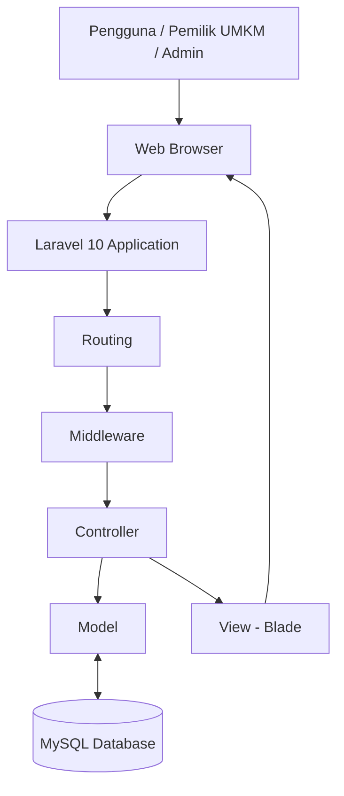

# UMKM Kita
### Kenali Potensi Lokal, Dukung UMKM Indonesia.

**UMKM Kita** merupakan platform digital berbasis web yang bertujuan untuk memperkenalkan, mempromosikan, dan mendukung perkembangan Usaha Mikro, Kecil, dan Menengah (UMKM) lokal. Platform ini menjadi wadah bagi masyarakat untuk mengenal berbagai produk unggulan daerah serta membantu pelaku UMKM memperluas jangkauan pemasaran dan mempermudah pembelian bagi masyarakat melalui teknologi digital.

---

## 1. Identitas Tim

| Keterangan | Informasi |
|---|---|
| White Owl | [White Owl] |
| Nama Aplikasi | UMKM Kita |
| Kategori | Web Application |
| Kompetisi | Hackathon |
| Tahun | 2026 |

### Anggota Tim

| No. | Nama Anggota | Peran |
|---|---|---|
| 1. | [Imam Wahyudi] | Ketua Tim |
| 2. | [Rifky Aditya Alim Pratama] | Anggota |
| 3. | [Luqmanul Hakim] | Anggota |
| 4. | [Mohamad Fahrur Rozi] | Anggota |

---

## 2. Deskripsi Aplikasi
### Latar Belakang Masalah

UMKM memiliki peran penting dalam mendukung perekonomian daerah. Namun, masih banyak pelaku UMKM yang mengalami kendala dalam memperkenalkan produk, menjangkau konsumen yang lebih luas, serta memanfaatkan teknologi digital sebagai sarana promosi.

Selain itu, proses pencarian dan pembelian produk UMKM terkadang masih kurang praktis. Sebagian calon pembeli cenderung enggan melakukan registrasi atau login hanya untuk melihat produk dan menghubungi penjual. Hal ini dapat menjadi hambatan bagi calon konsumen untuk mendapatkan informasi maupun melakukan transaksi.

Kurangnya media informasi yang terpusat dan mudah diakses juga membuat masyarakat kesulitan menemukan serta mengenal berbagai potensi produk unggulan dari UMKM lokal.

### Solusi yang Ditawarkan

UMKM Kita hadir sebagai platform digital yang menyediakan informasi dan katalog UMKM dalam satu tempat. Melalui platform ini, masyarakat dapat melihat berbagai produk, mengenal profil pelaku usaha, serta menemukan potensi unggulan daerah dengan lebih mudah.

Untuk memberikan pengalaman yang praktis, UMKM Kita menerapkan konsep akses tanpa login bagi pengunjung atau calon pembeli. Pengguna dapat langsung menjelajahi katalog, melihat detail produk, dan menghubungi penjual melalui WhatsApp tanpa perlu membuat akun atau melakukan proses autentikasi.

Ketika pengguna tertarik dengan suatu produk, sistem akan mengarahkan pengguna langsung ke WhatsApp milik pelaku UMKM sehingga komunikasi dan proses pemesanan dapat dilakukan secara langsung antara pembeli dan penjual.

Dengan konsep tersebut, UMKM Kita diharapkan dapat mengurangi hambatan akses bagi calon pembeli, mempermudah interaksi dengan pelaku UMKM, serta membantu memperluas jangkauan promosi produk lokal.

### Target Pengguna

1. **Pelaku UMKM:** Sebagai sarana untuk memperkenalkan usaha, menampilkan produk, dan memperluas jangkauan promosi kepada masyarakat melalui platform digital.

2. **Masyarakat/Konsumen:** Memudahkan masyarakat dalam menemukan, melihat, dan mengenal berbagai produk UMKM lokal tanpa perlu melakukan registrasi atau login. Calon pembeli juga dapat langsung menghubungi penjual melalui WhatsApp untuk menanyakan produk maupun melakukan pemesanan.

3. **Administrator:** Bertanggung jawab mengelola data UMKM, informasi produk, kategori, serta konten yang ditampilkan pada platform agar informasi tetap terorganisir dan akurat.

---

## 3. Fitur Utama

Berikut merupakan fitur utama yang dikembangkan dalam aplikasi UMKM Kita:
### Fitur Utama

| No. | Fitur | Deskripsi |
|---|---|---|
| 1 | Beranda | Menampilkan informasi, pengenalan platform, dan gambaran umum potensi UMKM lokal. |
| 2 | Kategori Produk | Mengelompokkan produk UMKM berdasarkan kategori untuk memudahkan pengunjung menemukan produk yang diinginkan. |
| 3 | Katalog Produk | Menampilkan daftar produk UMKM beserta foto, nama produk, harga, dan informasi singkat produk. |
| 4 | Detail Produk | Menampilkan informasi lengkap mengenai produk, termasuk deskripsi, harga, dan identitas UMKM pemilik produk. |
| 5 | Pemesanan melalui WhatsApp | Mengarahkan calon pembeli langsung ke WhatsApp pemilik UMKM untuk bertanya atau melakukan pemesanan tanpa perlu login. |
| 6 | Statistik UMKM | Menampilkan statistik jumlah UMKM berdasarkan skala usaha, seperti mikro, kecil, dan menengah. |
| 7 | Autentikasi Pemilik UMKM dan Admin | Menyediakan fitur login khusus bagi pemilik UMKM dan administrator untuk mengakses halaman pengelolaan. |
| 8 | Dashboard Pemilik UMKM | Memungkinkan pemilik UMKM mengelola profil usaha, informasi produk, harga, dan data usaha masing-masing. |
| 9 | Dashboard Admin | Memungkinkan administrator mengelola data UMKM, produk, kategori, pengguna, serta informasi yang ditampilkan pada platform. |

---

## 4. Teknologi yang Digunakan

Teknologi yang digunakan dalam pengembangan aplikasi UMKM Kita meliputi:

| Teknologi | Kegunaan |
|---|---|
| PHP | Bahasa pemrograman backend. |
| Laravel 10 | Framework pengembangan aplikasi web. |
| MySQL | Sistem manajemen basis data. |
| HTML5 | Struktur halaman web. |
| CSS3 | Mengatur tampilan dan desain aplikasi. |
| JavaScript | Menambahkan interaksi pada halaman web. |
| Bootstrap | Framework antarmuka pengguna. |
| jQuery | Mempermudah manipulasi DOM dan interaksi JavaScript. |
| Composer | Manajemen dependensi PHP. |
| Vite | Build tool untuk aset frontend. |
| Git & GitHub | Version control dan kolaborasi pengembangan. |

---

## 5. Arsitektur Sistem

Aplikasi UMKM Kita dikembangkan menggunakan framework **Laravel 10** 

### Diagram Arsitektur


### Penjelasan Komponen

| Komponen | Fungsi |
|---|---|
| Web Browser | Media untuk mengakses aplikasi UMKM Kita. |
| Laravel 10 | Framework utama yang menangani proses aplikasi. |
| Routing | Mengatur URL dan mengarahkan request ke Controller. |
| Middleware | Memeriksa hak akses pengguna, terutama untuk halaman Pemilik UMKM dan Admin. |
| Controller | Memproses permintaan dan menghubungkan Model dengan View. |
| Model | Mengelola interaksi dan pengolahan data dengan database. |
| MySQL Database | Menyimpan data UMKM, produk, kategori, pengguna, dan informasi lainnya. |
| View - Blade | Menampilkan halaman antarmuka aplikasi kepada pengguna. |

### Alur Data Aplikasi

1. Pengguna mengakses aplikasi melalui browser.
2. Request diterima oleh sistem routing Laravel.
3. Controller memproses permintaan pengguna.
4. Model berinteraksi dengan database MySQL apabila diperlukan.
5. Data dikirimkan kembali ke Controller.
6. View menampilkan informasi kepada pengguna.

---

## 6. Persyaratan Sistem

Sebelum menjalankan aplikasi, pastikan perangkat telah memiliki:

- PHP >= 8.1
- Composer
- MySQL atau MariaDB
- Node.js dan NPM
- Git
- Web Browser

---

## 7. Panduan Instalasi dan Menjalankan Aplikasi

Ikuti langkah-langkah berikut untuk menjalankan UMKM Kita di lingkungan lokal.

### A. Clone Repository

```bash
git clone https://github.com/yudi1588/umkm_kita.git
```

Masuk ke direktori project:

```bash
cd umkm_kita
```

### B. Install Dependencies

Install dependensi Laravel:

```bash
composer install
```

Install dependensi frontend:

```bash
npm install
```


### C. Konfigurasi Database

Buat database dengan nama `umkm_kita` melalui phpMyAdmin atau MySQL.

Kemudian sesuaikan konfigurasi pada file `.env`:

```env
APP_NAME="UMKM Kita"
APP_ENV=local
APP_KEY=
APP_DEBUG=true
APP_URL=http://127.0.0.1:8000

DB_CONNECTION=mysql
DB_HOST=127.0.0.1
DB_PORT=3306
DB_DATABASE=umkm_kita
DB_USERNAME=root
DB_PASSWORD=
```

### E. Migrasi Database

Jalankan perintah berikut:

```bash
php artisan migrate
```

### F. Menjalankan Aplikasi

Jalankan server Laravel:

```bash
php artisan serve
```

Jalankan Vite untuk kebutuhan frontend:

```bash
npm run dev
```

Akses aplikasi melalui browser:

```text
http://127.0.0.1:8000
```

---

## 8. Variabel Environment

Berikut beberapa variabel environment yang digunakan dalam konfigurasi aplikasi:

| Variabel | Keterangan |
|---|---|
| APP_NAME | UMKM kita |
| APP_ENV | |
| APP_KEY | |
| APP_DEBUG | |
| APP_URL | |
| DB_CONNECTION | Mysql |
| DB_HOST | |
| DB_PORT | |
| DB_DATABASE | umkm_kita |
| DB_USERNAME | |
| DB_PASSWORD | |

---


## 10. Dokumentasi Penggunaan AI


**Penggunaan AI:**
- [ChatGPT]

---

## 11. Atribusi dan Lisensi

Aplikasi UMKM Kita dikembangkan untuk keperluan kompetisi Hackathon tahun 2026.

Atribusi terhadap komponen pihak ketiga:

- Framework Laravel: https://laravel.com
- Bootstrap: https://getbootstrap.com
- jQuery: https://jquery.com
- Font Awesome: https://fontawesome.com


---

## 12. Penutup

UMKM Kita diharapkan dapat menjadi salah satu solusi digital dalam memperkenalkan potensi UMKM lokal kepada masyarakat luas. Melalui pemanfaatan teknologi, platform ini diharapkan mampu membantu meningkatkan visibilitas usaha lokal, memperluas akses informasi, serta mendorong perkembangan UMKM agar lebih dikenal dan mampu bersaing di era digital.

---

**UMKM Kita — Kenali Potensi Lokal, Dukung UMKM Indonesia.**

© 2026 UMKM Kita White Owl. All Rights Reserved.